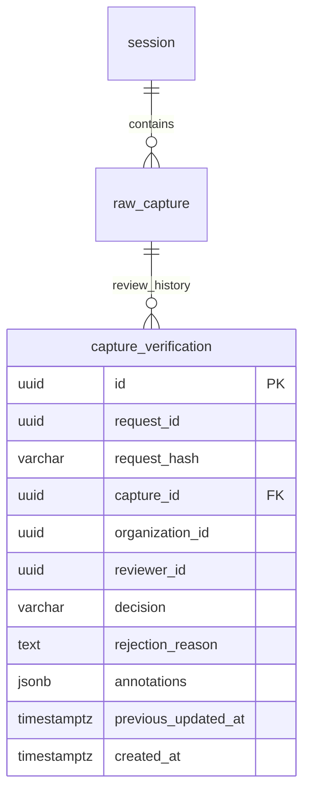

# NDM capture verification history

Added through the Admin Panel domain integration. Migration `20261122100000-capture-verification-audit` adds review history without altering existing raw capture ownership or inventing prior reviews.

Each row stores the real authenticated reviewer UUID, organization UUID, capture UUID, decision, required rejection reason, classification annotations, previous exact capture version and timestamp. Request UUID plus payload hash supports replay protection; `(request_id,capture_id)` is unique. Actor UUID is a Keycloak identity, not a local fabricated user.

The Admin API performs status changes and audit inserts atomically after permission/version checks. Approval creates an NDM `treetracker.capture` and raised domain event. Queue publication/matching is a separate deployment dependency. This migration does not create legacy trees or modify Keycloak.

Applied in dev only, with apply/rollback savepoint rehearsal and disposable fixture checks covering approve/reject, stale batch rollback, idempotency and actor attribution. Down migration drops history: use only when rollback data loss is acceptable.
