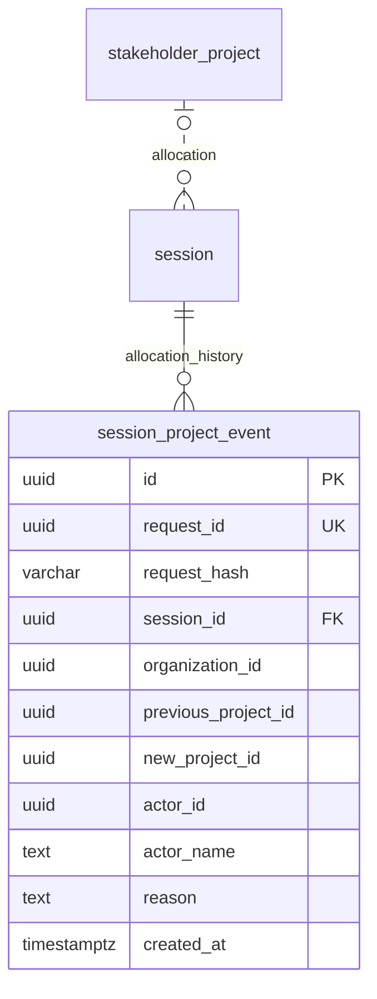

# Session project correction history

Migration `20261122130000-session-project-audit` adds an application audit trail for administrative corrections to the app-supplied session project allocation. Added through the Admin Panel NDM integration. The existing session project column is supplied by Field Data #121.

Admin API #699 supports assign/reassign/clear with a required reason and `manage_projects`. It validates that the target project is active in the session's organization, locks the session and version-checks both current project and latest event, then changes `session.project_id` and appends history in one transaction. Replays are idempotent; stale and ABA changes conflict. Project UUIDs refer to Stakeholder; actor UUID is the real authenticated Keycloak user. No cross-service foreign keys are introduced.

The previous allocation is recorded on the first correction without inventing its original actor. Grower memberships, capture decisions and tree associations are unchanged. Captures inherit project reporting through their session. Existing rows are not reassigned or backfilled. Down migration drops correction history.

Dev validation: migration apply/rollback savepoint rehearsal; disposable synthetic tests for assign/reassign/clear, actor/reason/history, stale/ABA conflicts, replay, cross-organization rejection and unchanged verification/membership.

Automatic mobile allocation remains separate ingestion work: current `server/handlers/sessionHandler/schemas.js` omits `project_id` and rejects unknown fields; `SessionModel` omits it from responses. Extend that contract with an explicit app-selected project, validate session organization and keep session creation retries from overwriting administrative corrections. Do not infer one project from a grower with multiple project memberships.
